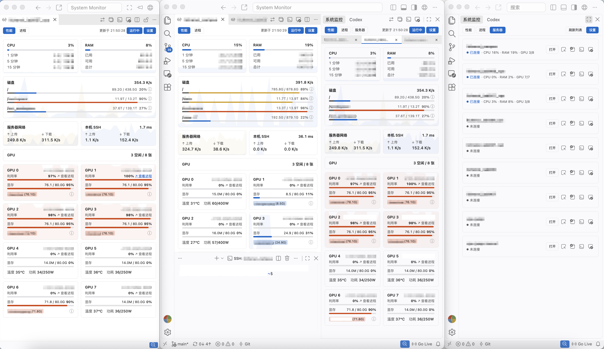
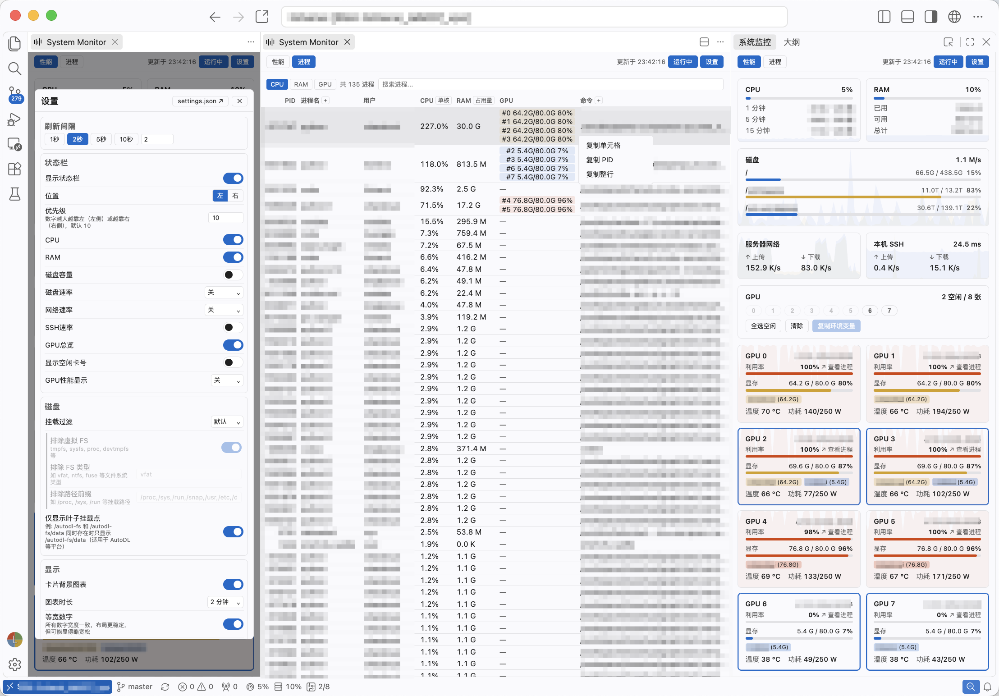

# System Monitor

[](https://marketplace.visualstudio.com/items?itemName=LiChenxi.sysmonitor)
[](https://marketplace.visualstudio.com/items?itemName=LiChenxi.sysmonitor)
[](https://marketplace.visualstudio.com/items?itemName=LiChenxi.sysmonitor)
[](https://open-vsx.org/extension/LiChenxi/sysmonitor)
[](https://open-vsx.org/extension/LiChenxi/sysmonitor)
[](https://github.com/lcx-0504/sysmonitor)
[](LICENSE)

[简体中文](README.zh-CN.md) · [繁體中文](README.zh-TW.md)

System Monitor is a Linux system monitoring extension for VS Code and compatible editors such as Cursor and Windsurf, with a monitoring panel and status-bar indicators. It supports local Linux machines and remote SSH servers, and runs inside Remote-SSH, WSL, and Linux containers.

Connect through SSH from a local Linux, macOS, or Windows window, or monitor the current machine directly in a Linux environment provided by Remote-SSH, WSL, or Dev Containers. Monitoring panels can be displayed in the sidebar, editor tabs, and separate monitoring windows.

Monitor the local Linux machine, when available, and multiple connected servers from a local window.



Monitor the currently connected server from a Remote-SSH window.



The interface follows your editor's theme and display language, with English, Simplified Chinese, and Traditional Chinese support.

## Get started

Install **System Monitor** from [VS Marketplace](https://marketplace.visualstudio.com/items?itemName=LiChenxi.sysmonitor) or [Open VSX](https://open-vsx.org/extension/LiChenxi/sysmonitor), then open the **System Monitor** view.

| Your environment | How to use it |
|---|---|
| Local Linux | View the local machine immediately. Use **Servers** to open other Linux hosts from your SSH config. |
| Local macOS or Windows | Choose a Linux host from **Servers**. Monitoring your local macOS or Windows machine is not supported. |
| Remote-SSH, WSL, or Dev Container on Linux | Install or enable the extension in that remote environment to monitor the machine where it runs. |

### Connect from a local window

The server list reads host aliases from your SSH config. It uses `remote.SSH.configFile` when configured, otherwise `~/.ssh/config` (or `%USERPROFILE%\.ssh\config` on Windows), and supports included config files.

Background monitoring needs a working system `ssh` client and a connection that does not require an interactive password, key-passphrase, or verification-code prompt. SSH keys, an SSH agent, or an already authenticated reusable SSH connection can provide this. To check, replace `your-server` with your host alias and run:

```sh
ssh -T -o BatchMode=yes your-server true
```

If it completes successfully without asking for input, choose that host in **Servers** and click **Open**. The SSH terminal shortcut remains available for interactive logins.

To install System Monitor automatically in future Remote-SSH windows, click **Add to defaults** in **Settings → Servers**. Remote-SSH will install the published Marketplace version.

## Features

### Resource monitoring and trends

The Performance page displays CPU usage and load averages, memory capacity and usage, disk capacity and I/O, network rates, and GPU metrics. CPU, memory, and GPU cards include utilization trends; disk and network cards show rate changes.

Chart duration, visible resource groups, and background charts are configurable. Disk information controls show used, reserved, and available space. Disk filters support mount selection and filesystem or path exclusions.

### GPU monitoring and idle-card selection

GPU cards display utilization, VRAM, temperature, power, and utilization trends. The GPU overview uses occupation-process information to identify idle cards and supports card selection with a copyable `CUDA_VISIBLE_DEVICES` setting.

GPU measurements remain visible if the process query fails. When occupancy is unknown, the idle count shows `--` and the affected cards cannot be selected.

GPUs used by the current user have a border in the editor's accent color. User labels show per-user VRAM usage, with the full user list available on hover. User labels and ownership highlighting can be disabled independently.

**View Procs** opens the process list for a GPU. NVIDIA monitoring requires `nvidia-smi` on the monitored machine. An idle GPU has no occupying tasks in the collected compute-process list.

### Process list

The Processes page supports sorting by CPU, memory, or GPU memory usage and searching by name, PID, user, command, or tmux/screen session name. To reduce transfer size, the monitored machine first excludes processes using no more than about 1 MB of memory with no current CPU usage (mostly idle kernel threads), then selects the top 100 processes in each ranking: the CPU ranking includes only processes with current CPU usage above zero, the GPU ranking includes only processes using GPU memory, and the memory ranking has no such restriction. In addition, up to 100 programs that the current user runs inside tmux/screen sessions (excluding the pane or window shells and the SCREEN server) are always returned, however low they rank. These groups are merged into at most 400 unique candidates. Each view sorts these candidates independently and displays the top 100 results, plus any session programs outside them, placed according to the current sort column. Search applies to this candidate set; `GPU0`, `GPU 0`, and `#0` filter processes using a specific GPU.

The count at the top of the page shows the total number of processes after this exclusion, including during a search; it can vary slightly as kernel threads become active or idle. When there are more than 100 processes, a note at the end of the table reads “Showing the top 100 processes” and adds the number of extra session processes shown. During a search, the note instead reports how many results were found among the candidates. When the candidates do not cover every process, an ⓘ icon beside the note explains that search covers only the top 100 processes by CPU, memory, and GPU memory usage, and during a search the note also states that results may be incomplete.

Process CPU usage reflects current activity. Each collection reads `/proc/PID/stat` twice, half a refresh interval apart and at most 1 second apart, and calculates usage from the difference instead of using the average since process start reported by `ps`.

Process names and commands support expanded and collapsed views. The context menu copies a PID, cell, or row. While the context menu is open, or while a tmux/screen label is hovered or focused, the list stops refreshing so that rows stay in place; the latest data appears as soon as the menu closes or the pointer leaves the label. CPU usage supports per-core, whole-machine, or combined display; memory supports capacity, percentage, or both. These display choices are global preferences: a change in one view applies to all monitor views.

Processes of the current user that run in a tmux pane or a screen session show a `tmux` or `screen` label before the process name. When the process-name column is expanded, the label also shows the session name, and the process-name tooltip shows it as `tmux: session-name`. The current user is the user running the collection: the SSH login user for servers monitored from a local window, otherwise the user running the extension on the monitored machine. Detecting sessions requires the `tmux` or `screen` command on that machine.

Click the label, or choose **Open tmux Session in Terminal** or **Open screen Session in Terminal** from the context menu, to open the session in a terminal. For tmux, the terminal attaches to the session without switching its current window; for screen, it runs `screen -x`. Remote windows, such as Remote-SSH, and the local machine use the integrated terminal, and servers monitored from a local window open through `ssh -t`. After the session is detached, the terminal remains open with a shell. If the session is also attached elsewhere, both terminals share input, and the session's window size may change to fit the new terminal.

### Multiple-server monitoring

In a local window, the server list reads SSH host aliases and displays connection status with CPU, memory, and GPU summaries. Multiple servers can be monitored simultaneously. Device tabs support drag-to-reorder and workspace restoration. Open monitors continue refreshing in the background by default, with an option to refresh visible panels only.

### Multiple windows and quick actions

Supports sidebar views, editor tabs, and separate monitoring windows. Title-bar actions create, switch, and move views. Views of the same server share monitoring data.

The sidebar does not keep its page loaded while hidden. When it is shown again, it reloads with its chart history, current page, and selected device. The process search, sort column, and selected GPUs are also restored after a reload, both in the sidebar and in editor tabs.

Editor, new-window, SSH-terminal, and remote-window shortcuts can be shown or hidden independently. The remote-window action supports new workspaces, recent workspaces, and a menu of recent locations. Settings also provide Remote-SSH auto-install.

### Status-bar monitoring

Local and remote Linux environments support status-bar monitoring, with CPU, memory, disk, network, SSH, and GPU indicators at the bottom of the editor and detailed configuration options. For example, GPU indicators can show summaries, idle card IDs, selected card IDs, or only GPUs used by the current user. Indicators and their position are configurable.

### Themes and interface settings

The interface follows the editor's light or dark theme, using its backgrounds, text, and accent color, with a responsive layout. High utilization uses warning colors. Card layout and top-bar controls adapt to available width, with some actions placed in a **…** menu in narrow views.

### Privacy and runtime requirements

The extension reads system information and displays it in your editor. It has no telemetry and uploads no resource metrics, process lists, usernames, or SSH configuration to a third-party monitoring service. SSH uses your system client and existing authentication configuration. It exchanges no data with servers other than the SSH hosts selected for connection. To label tmux and screen processes, the extension lists the current user's sessions with `tmux list-panes` and `screen -ls`; it attaches to a session only when you open that session in a terminal.

Local SSH monitoring needs no agent or monitoring service installed on the server, creates no monitoring temporary files, and requires no Python. In a remote Linux window, monitoring runs through the extension installed there by VS Code.

System Monitor requires VS Code 1.85 or later. Compatible editors need to be based on VS Code 1.85 or later.

## Settings

Metrics disabled in both the panel and status bar stop collecting, and their server-list summaries are hidden. Disabling all GPU displays also hides GPU information on the Processes page. Enabling a metric resumes its collection.

The default refresh interval is 2 seconds and is configurable in the monitor. Settings also cover chart duration, visible resource groups, the status bar, disk filters, and quick actions.

After the first connection or a change to the monitoring connections, SSH latency appears first; upload and download rates become available after the next successful refresh. If settings cannot be saved, the dialog shows the error and provides a retry button.

**Custom collection policy** in **Connection and collection** provides three timeout settings: 15 seconds for SSH connections; 10 seconds for standard collection of CPU, memory, network, disk I/O, and SSH metrics; and 30 seconds for extended collection of disk capacity, process lists, and GPU metrics. When enabled, each can be set from 5 to 120 seconds. Turning it off uses the defaults and keeps the entered values. Longer timeouts can accommodate slower connections or busy servers. The SSH connection pool limit applies to monitoring from a local window. Each server uses up to 4 connections by default, adjustable from 1 to 8, opened on demand. Turning the custom policy off uses the default pool size and timeouts. While monitoring is paused, or while a monitor stops refreshing because only visible panels are refreshed, each server keeps only one SSH connection. In `settings.json`, this policy is the `sysmonitor.collection` setting, with the properties `custom`, `connectionTimeout`, `standardTimeout`, `extendedTimeout`, and `sshPoolSize`.

**Refresh visible panels only** reduces background collection, but a monitor needs to reload when brought to the foreground. This option can be useful when monitoring many servers. Settings are saved to VS Code User configuration and apply to all monitoring views.

## Questions and troubleshooting

### A server is missing or will not connect

Check the SSH config selected by VS Code, then refresh the Servers list. Entries need explicit `Host` aliases; wildcard patterns are not listed as individual servers.

Test authentication with the non-interactive SSH command shown above. For a passphrase-protected private key, load the key into an SSH agent first. If the server requires TOTP or another interactive authentication step, complete it in a terminal or through an existing trusted authentication script and establish a reusable SSH master connection.

If the local SSH client supports and is configured for [connection multiplexing](https://man.openbsd.org/ssh_config#ControlMaster), using options such as `ControlMaster`, `ControlPath`, and `ControlPersist`, the extension can reuse the authenticated connection. Run the test command again to confirm. Authentication is needed again when the master connection closes or expires.

If connection multiplexing is unavailable or non-interactive access still fails, use **Open Remote Window** to sign in through Remote-SSH, then install or enable System Monitor in that remote window to monitor the server directly.

### GPU, SSH, or process information is unavailable

Check that `nvidia-smi` works on the monitored machine for NVIDIA metrics. SSH traffic and latency require the Linux `ss` command and accessible TCP statistics. Missing optional metrics do not prevent other sections from working.

With SSH connection multiplexing, traffic figures can include other sessions sharing the same TCP connection.

The process list requires a `ps` command that supports the required output format, such as the one provided by procps. With BusyBox `ps`, the collection-error banner reports that the format is not supported and suggests installing procps.

### Disk usage looks different from “used space”

The disk bar includes space unavailable to ordinary users, such as filesystem reserves. Hover over the information icon to see the breakdown. Mounts without usable capacity information are omitted.

### Collection times out or monitoring pauses automatically

Check the network and server load, and try a longer refresh interval. Existing views keep their last available data when collection fails.

Retrying from the collection-error banner keeps the existing errors visible with a “Collecting” indicator. Each error clears when its metric is successfully collected.

When several collection processes are confirmed to remain after interrupted SSH requests, the extension pauses monitoring and displays their PIDs for inspection. Dismissing the notice does not resume monitoring; resume it manually after checking the server.

When a usable `timeout` tool is available on the server, remote collection commands run with an execution time limit. System I/O waits can still delay process exit. The extension reports confirmed remaining collection processes for inspection and leaves any process cleanup to you.

## Feedback

For bugs or feature requests, open a [GitHub issue](https://github.com/lcx-0504/sysmonitor/issues). For connection problems, include the relevant error, your local and remote operating systems, and whether you use local SSH monitoring or a remote window. Remove passwords, tokens, and other private information from logs before sharing them.

See the [changelog](CHANGELOG.md) for release notes.

## Contributors

<a href="https://github.com/lcx-0504" title="Author"></a>
<a href="https://github.com/klay7w" title="Helped fix GPU refresh stability"></a>

## License

[MIT](LICENSE)
