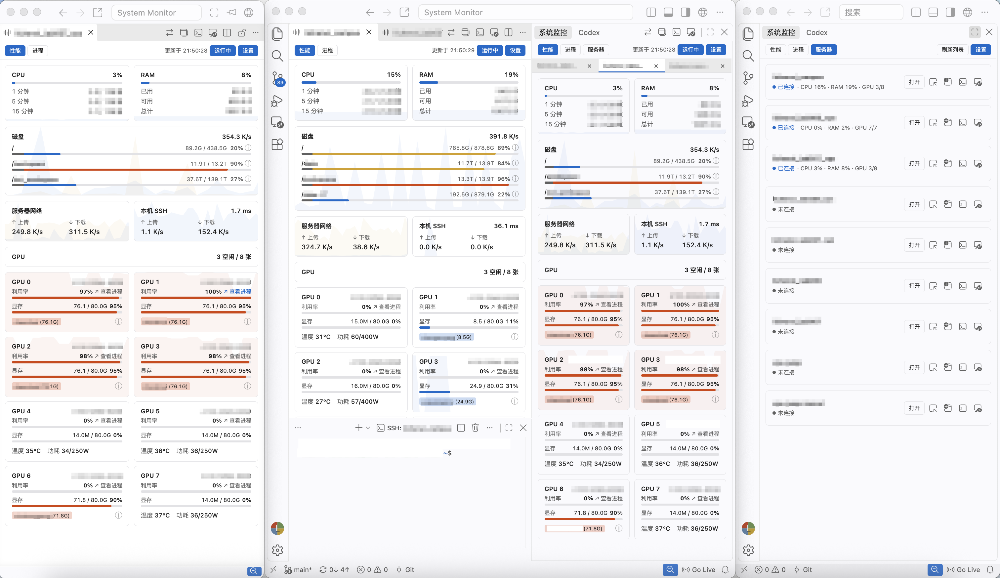
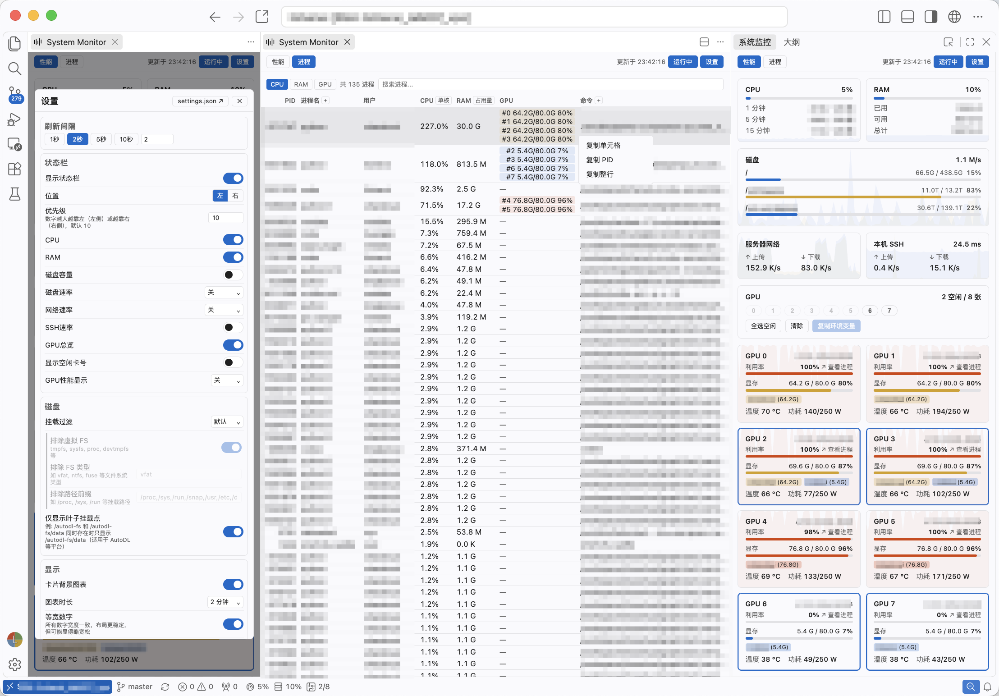

# System Monitor — 系统监控

[](https://marketplace.visualstudio.com/items?itemName=LiChenxi.sysmonitor)
[](https://marketplace.visualstudio.com/items?itemName=LiChenxi.sysmonitor)
[](https://marketplace.visualstudio.com/items?itemName=LiChenxi.sysmonitor)
[](https://open-vsx.org/extension/LiChenxi/sysmonitor)
[](https://open-vsx.org/extension/LiChenxi/sysmonitor)
[](https://github.com/lcx-0504/sysmonitor)
[](LICENSE)

[English](README.md) · [繁體中文](README.zh-TW.md)

System Monitor 是面向 VS Code 及其衍生版本（如 Cursor、Windsurf）的 Linux 系统监控扩展，显示面板和状态栏。支持监控本地 Linux 和 SSH 远程服务器，也可在 Remote-SSH、WSL 和 Linux 容器中使用。

从 Linux、macOS 或 Windows 本地窗口通过 SSH 连接监控，也可以在 Remote-SSH、WSL、Dev Container 的 Linux 环境中直接监控当前机器。监控面板可显示在侧栏、编辑器标签页和独立监控窗口多个位置。

在本地窗口中查看本机Linux（如有）以及多台连接的服务器。



在 Remote-SSH 窗口中查看当前连接的服务器。



界面跟随编辑器主题和显示语言，支持英文、简体中文与繁体中文。

## 快速开始

从 [VS Marketplace](https://marketplace.visualstudio.com/items?itemName=LiChenxi.sysmonitor) 或 [Open VSX](https://open-vsx.org/extension/LiChenxi/sysmonitor) 安装 **System Monitor**，然后打开「系统监控」视图。

| 运行环境 | 使用方式 |
|---|---|
| 本地 Linux | 直接查看本机；进入「服务器」页，还可以打开 SSH 配置中的其他 Linux 服务器。 |
| 本地 macOS 或 Windows | 在「服务器」页选择 Linux 主机。暂不支持监控当前 macOS 或 Windows 电脑。 |
| Remote-SSH、WSL 或 Dev Container 中的 Linux | 在对应远程环境中安装或启用扩展，查看扩展所在机器的状态。 |

### 从本地窗口连接服务器

服务器列表读取 SSH 配置中的主机别名，优先使用 VS Code 的 `remote.SSH.configFile`，否则读取 `~/.ssh/config`（Windows 为 `%USERPROFILE%\.ssh\config`），也支持通过 `Include` 引入的配置文件。

后台采集需要本地有可用的 `ssh` 命令，并能够以非交互方式完成认证，即无需临时输入密码、私钥口令或验证码。可以使用 SSH 密钥、SSH agent（密钥代理）或已经完成认证的可复用连接。将下面的 `your-server` 替换为主机别名，可验证连接是否满足要求：

```sh
ssh -T -o BatchMode=yes your-server true
```

验证通过后，在「服务器」页选择主机并点击「打开」。需要交互式登录时，可以使用 SSH 终端快捷按钮。

如需在新建 Remote-SSH 窗口时自动安装本扩展，可在「设置 → 服务器」中点击「加入默认扩展」。Remote-SSH 会安装扩展市场上的已发布版本。

## 功能

### 性能监控与趋势图

「性能」页展示 CPU 使用率与平均负载、内存容量与占用、磁盘容量与读写速率、网络速率，以及 GPU 状态。CPU、内存和 GPU 卡片提供利用率趋势图，磁盘与网络卡片展示速率变化。

支持调整图表时间范围、选择显示分组和关闭背景图表。磁盘信息按钮提供已用、预留和可用空间明细，磁盘过滤设置支持选择挂载点与排除文件系统或路径。

### GPU 监控与空闲卡选择

GPU 卡片展示利用率、显存、温度、功耗和利用率趋势。GPU 总览按占用进程信息统计空闲卡，支持选择空闲卡并复制对应的 `CUDA_VISIBLE_DEVICES` 设置。

进程信息查询失败时，已取得的 GPU 指标仍会显示；占用情况未知时，空闲数量显示为 `--`，对应卡片暂不可选择。

当前用户正在使用的 GPU 以主题强调色高亮边框。用户标签展示各用户的显存占用，多人共用的 GPU 支持悬停查看完整用户列表；用户标签和边框高亮支持分别关闭。

「查看进程」链接可跳转至对应 GPU 的进程列表。NVIDIA GPU 监控需要被监控机器上有可用的 `nvidia-smi`；空闲状态表示当前采集的计算进程列表中没有任务占用该 GPU。

### 进程列表

「进程」页支持按 CPU、内存或 GPU 显存占用排序，以及按进程名、PID、用户、命令或 tmux/screen 会话名搜索。为减少传输量，被监控机器先排除内存不超过约 1 MB 且当前 CPU 占用为 0 的进程（主要是空闲的内核线程），再分别取三项排名的前 100 条：CPU 排名只包含当前 CPU 占用大于 0 的进程，GPU 排名只包含占用显存的进程，内存排名不设此限制。三项合并去重后最多返回 300 条候选记录，各窗口独立排序并显示前 100 条。搜索在这些候选记录中进行，`GPU0`、`GPU 0` 和 `#0` 可筛选指定 GPU 上的进程。

页面顶部的进程计数显示上述排除之后的进程总数，搜索时也不变；内核线程的活跃状态变化时，该数字会略有浮动。进程总数超过 100 时，表格下方显示“显示前 100 个进程”；搜索时，该行改为说明在多少个候选进程中搜索到多少个结果。候选记录未覆盖全部进程时，该行旁边显示 ⓘ 图标，说明搜索只在 CPU、内存、GPU 显存占用各前 100 的进程中进行；搜索时，说明中还会提示“搜索结果可能不完全”。

进程 CPU 占用反映当前状态：每次采集读取两次 `/proc/PID/stat`，间隔为刷新间隔的一半且不超过 1 秒，根据两次读数之差计算，而不是使用 `ps` 给出的自进程启动以来的平均值。

进程名和命令列支持展开与收起，右键菜单支持复制 PID、单元格或整行。CPU 支持单核占比、整机占比或同时显示；内存支持占用量、占比或同时显示。这些显示方式为全局偏好，在任一视图中修改后，所有监控视图同步生效。

当前用户的进程若运行在 tmux 窗格或 screen 会话中，进程名前会显示 `tmux` 或 `screen` 标签；展开进程名列时，标签同时显示会话名，进程名的悬停提示以 `tmux: 会话名` 的形式显示会话。当前用户指执行采集的用户：从本地窗口监控服务器时为 SSH 登录用户，其他情况下为被监控机器上运行扩展的用户。识别会话需要该机器上有 `tmux` 或 `screen` 命令。

点击标签，或在右键菜单中选择「在终端中打开 tmux 会话」或「在终端中打开 screen 会话」，即可在终端中打开该会话。tmux 只连接会话，不切换其当前窗口；screen 使用 `screen -x` 连接。Remote-SSH 等远程窗口和本机使用集成终端，从本地窗口监控的服务器通过 `ssh -t` 打开。会话分离后，终端保留一个 shell。如果该会话同时在其他地方连接，两端共享输入，会话的窗口尺寸也可能随新终端的大小调整。

### 多服务器监控

在本地窗口中，服务器列表读取 SSH 配置中的主机别名，并显示连接状态、CPU、内存与 GPU 概况。支持同时监控多台服务器，设备标签支持拖动排序与工作区恢复。已打开的监控默认继续在后台刷新，也支持仅刷新可见面板。

### 多窗口与快捷操作

支持侧栏监控、编辑器标签页和独立监控窗口。顶栏提供新建、切换与移动视图的操作，同一服务器的多个监控视图共享数据。

侧栏隐藏时不保留页面内容，重新显示时重新加载，并恢复图表历史、当前页面和选中的设备。重新加载后，侧栏和编辑器标签页还会恢复进程搜索词、排序列和已选的 GPU。

提供编辑器、新窗口、SSH 终端和远程窗口四类快捷操作，支持分别显隐。远程窗口支持打开新工作区、最近工作区或通过菜单选择历史位置。设置中还提供 Remote-SSH 自动安装选项。

### 状态栏监控

本地或远程 Linux 环境支持状态栏监控，可在编辑器底部显示 CPU、内存、磁盘、网络、SSH 与 GPU 指标，并有详细的选项设置。例如 GPU 支持总览、空闲卡号、指定卡号或仅显示当前用户使用的 GPU。显示指标与状态栏位置均可配置。

### 主题与界面设置

界面跟随编辑器的深浅色主题，使用当前主题的背景、文字和强调色，并支持响应式布局。高负载指标采用警示颜色，卡片布局与顶栏操作根据可用宽度调整；较窄的视图中，部分操作收纳至「…」菜单。

### 隐私说明与运行环境

扩展读取系统信息并在编辑器中展示，不含遥测，也不向第三方监控服务上传资源指标、进程列表、用户名或 SSH 配置。SSH 使用系统客户端与已有认证配置，除指定连接的 SSH 主机外，不向任何其他服务器收发数据。为标记 tmux 和 screen 中的进程，扩展会通过 `tmux list-panes` 和 `screen -ls` 列出当前用户的会话；只有在用户选择在终端中打开会话时，才会连接该会话。

本地 SSH 监控无需在服务器上安装代理或监控服务，无监控临时文件，也无需 Python。在远程 Linux 窗口中，则由 VS Code 安装在该环境中的扩展执行监控。

扩展需要 VS Code 1.85 或更高版本；衍生编辑器需基于 VS Code 1.85 或更高版本。

## 设置

在面板和状态栏中均关闭的指标会停止采集，服务器列表的对应摘要也随之隐藏。关闭全部 GPU 显示后，进程页隐藏 GPU 信息；重新启用时恢复采集。

默认刷新间隔为 2 秒，可在监控设置中调整。设置同时提供图表时间范围、显示分组、状态栏、磁盘过滤和快捷操作等选项。

首次连接或监控连接发生变化后，SSH 延迟先显示，上传和下载速率在下一次成功刷新后出现。设置保存失败时，弹窗会提示原因并提供重试按钮。

「连接与采集」中的「自定义采集策略」提供三项超时设置：SSH 连接默认 15 秒；CPU、内存、网络、磁盘读写和 SSH 指标的常规采集默认 10 秒；磁盘容量、进程列表和 GPU 的扩展采集默认 30 秒。开启后，各项支持设置为 5～120 秒；关闭时使用默认超时，并保留已填写的自定义数值。连接较慢或服务器繁忙时可适当增加。SSH 连接池上限用于本地窗口监控，默认每台服务器最多 4 条连接，可设置为 1～8，连接按需建立。关闭自定义策略时，连接池与超时均使用默认值。监控暂停，或因「仅刷新可见面板」而停止刷新时，每台服务器只保留一条 SSH 连接。在 `settings.json` 中，该策略对应 `sysmonitor.collection` 设置，属性为 `custom`、`connectionTimeout`、`standardTimeout`、`extendedTimeout` 和 `sshPoolSize`。

「仅刷新可见面板」用于减少后台采集，但切换到前台时需要重新加载，监控服务器较多时可启用。设置保存到 VS Code 用户配置，并在各个监控视图中生效。

## 常见问题

### 服务器没有出现在列表中，或者连接失败

检查 VS Code 使用的 SSH 配置文件，然后刷新服务器列表。主机需要有明确的 `Host` 别名，通配符不会单独显示为服务器条目。

可先使用上面的非交互式 SSH 测试命令检查认证。使用带口令的 SSH 私钥时，可以先将密钥加载到 SSH agent。对于需要 TOTP 等交互认证的服务器，可以先在终端或通过已有的可信认证脚本完成认证，并建立可复用的 SSH 主连接。

如果本地 SSH 支持并已配置[连接复用](https://man.openbsd.org/ssh_config#ControlMaster)（如 `ControlMaster`、`ControlPath` 和 `ControlPersist`），扩展可以复用已认证的连接进行后台采集。完成认证后，再运行上述测试命令确认；主连接断开或过期后，需要重新认证。

如果当前环境不支持连接复用，或仍无法完成非交互式连接，可以使用「打开远程窗口」通过 Remote-SSH 完成登录，再在远程窗口中安装或启用 System Monitor，直接监控该服务器。

### GPU、SSH 指标或进程列表不可用

NVIDIA GPU 指标需要被监控机器上的 `nvidia-smi` 能正常运行。SSH 流量和延迟需要 Linux 的 `ss` 命令及可读取的 TCP 统计信息；某项可选指标不可用时，其他监控区域仍可使用。

使用 SSH 连接复用时，流量读数可能包含共享同一 TCP 连接的其他会话。

进程列表需要支持所需输出格式的 `ps` 命令，例如 procps 提供的版本。使用 BusyBox 的 `ps` 时，采集错误横幅会说明格式不受支持，并建议安装 procps。

### 磁盘占用与“已用空间”为何不同

磁盘占用包含普通用户无法使用的空间，例如文件系统预留空间。悬停信息图标即可查看各项明细；没有有效容量信息的挂载点不显示。

### 采集频繁超时，或者监控自动暂停

检查网络与服务器负载，并尝试增大刷新间隔。采集失败时，已有视图会保留最后可用的数据。

点击采集错误横幅中的重试按钮后，原错误会保留并显示“采集中”。对应指标采集成功后，错误提示自动清除。

如果确认多条 SSH 采集任务在连接中断后仍未退出，扩展会暂停监控并提示对应 PID，供用户复制和检查。关闭提示后不会自动恢复，检查完成后可手动恢复监控。

服务器上有可用的 `timeout` 工具时，远端采集命令会设置执行期限。系统 I/O 阻塞等情况仍可能延迟进程退出，扩展会报告确认仍在运行的采集进程，供用户检查并决定是否清理。

## 反馈

遇到问题或有功能建议，可以提交 [GitHub Issue](https://github.com/lcx-0504/sysmonitor/issues)。连接问题请说明本地和远端系统、使用的是本地 SSH 监控还是远程窗口，并附上相关错误信息。分享日志前，请移除密码、令牌和其他隐私信息。

版本变化见[更新记录](CHANGELOG.md)。

## 贡献者

<a href="https://github.com/lcx-0504" title="作者"></a>
<a href="https://github.com/klay7w" title="协助修复 GPU 刷新稳定性"></a>

## 许可

[MIT](LICENSE)
