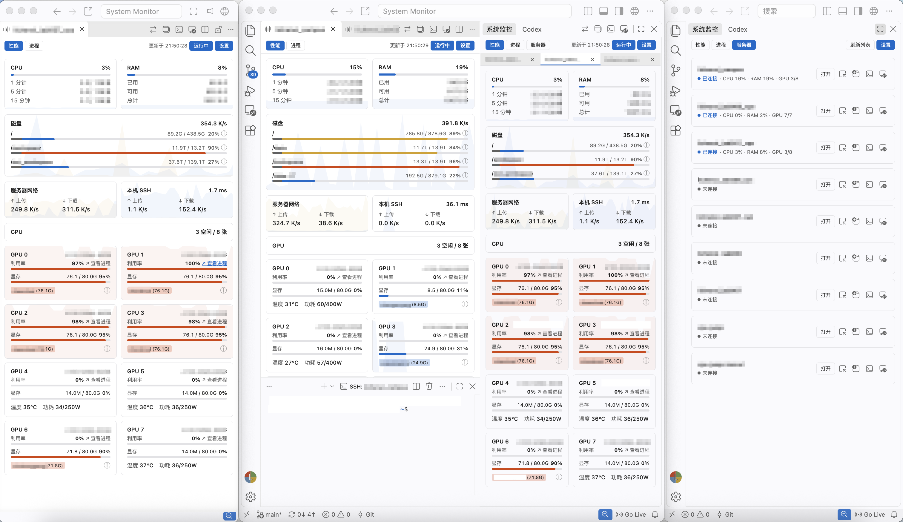
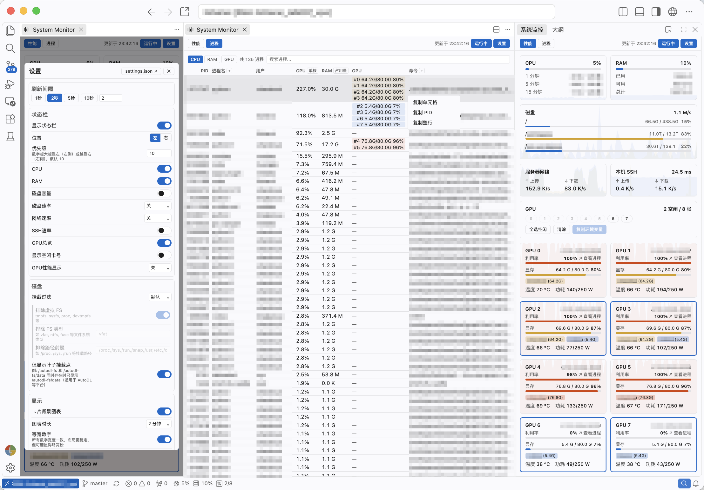

# System Monitor — 系統監控

[](https://marketplace.visualstudio.com/items?itemName=LiChenxi.sysmonitor)
[](https://marketplace.visualstudio.com/items?itemName=LiChenxi.sysmonitor)
[](https://marketplace.visualstudio.com/items?itemName=LiChenxi.sysmonitor)
[](https://open-vsx.org/extension/LiChenxi/sysmonitor)
[](https://open-vsx.org/extension/LiChenxi/sysmonitor)
[](https://github.com/lcx-0504/sysmonitor)
[](LICENSE)

[English](README.md) · [简体中文](README.zh-CN.md)

System Monitor 是面向 VS Code 及其衍生版本（如 Cursor、Windsurf）的 Linux 系統監控擴展，顯示面板和狀態欄。支持監控本地 Linux 和 SSH 遠端伺服器，也可在 Remote-SSH、WSL 和 Linux 容器中使用。

從 Linux、macOS 或 Windows 本地視窗通過 SSH 連接監控，也可以在 Remote-SSH、WSL、Dev Container 的 Linux 環境中直接監控當前機器。監控面板可顯示在側欄、編輯器標籤頁和獨立監控視窗多個位置。

在本地視窗中查看本機Linux（如有）以及多台連接的伺服器。



在 Remote-SSH 視窗中查看當前連接的伺服器。



界面跟隨編輯器主題和顯示語言，支持英文、簡體中文與繁體中文。

## 快速開始

從 [VS Marketplace](https://marketplace.visualstudio.com/items?itemName=LiChenxi.sysmonitor) 或 [Open VSX](https://open-vsx.org/extension/LiChenxi/sysmonitor) 安裝 **System Monitor**，然後打開「系統監控」視圖。

| 運行環境 | 使用方式 |
|---|---|
| 本地 Linux | 直接查看本機；進入「伺服器」頁，還可以打開 SSH 配置中的其他 Linux 伺服器。 |
| 本地 macOS 或 Windows | 在「伺服器」頁選擇 Linux 主機。暫不支持監控當前 macOS 或 Windows 電腦。 |
| Remote-SSH、WSL 或 Dev Container 中的 Linux | 在對應遠端環境中安裝或啓用擴展，查看擴展所在機器的狀態。 |

### 從本地視窗連接伺服器

伺服器列表讀取 SSH 配置中的主機別名，優先使用 VS Code 的 `remote.SSH.configFile`，否則讀取 `~/.ssh/config`（Windows 為 `%USERPROFILE%\.ssh\config`），也支持通過 `Include` 引入的配置檔案。

後台採集需要本地有可用的 `ssh` 命令，並能夠以非交互方式完成認證，即無需臨時輸入密碼、私鑰口令或驗證碼。可以使用 SSH 密鑰、SSH agent（密鑰代理）或已經完成認證的可復用連接。將下面的 `your-server` 替換為主機別名，可驗證連接是否滿足要求：

```sh
ssh -T -o BatchMode=yes your-server true
```

驗證通過後，在「伺服器」頁選擇主機並點擊「打開」。需要交互式登錄時，可以使用 SSH 終端快捷按鈕。

如需在新建 Remote-SSH 視窗時自動安裝本擴展，可在「設定 → 伺服器」中點擊「加入預設擴展」。Remote-SSH 會安裝擴展市場上的已發佈版本。

## 功能

### 性能監控與趨勢圖

「性能」頁展示 CPU 使用率與平均負載、記憶體容量與佔用、磁碟容量與讀寫速率、網路速率，以及 GPU 狀態。CPU、記憶體和 GPU 卡片提供利用率趨勢圖，磁碟與網路卡片展示速率變化。

支持調整圖表時間範圍、選擇顯示分組和關閉背景圖表。磁碟信息按鈕提供已用、預留和可用空間明細，磁碟過濾設定支持選擇掛載點與排除檔案系統或路徑。

### GPU 監控與空閒卡選擇

GPU 卡片展示利用率、顯示記憶體、溫度、功耗和利用率趨勢。GPU 總覽按佔用程序信息統計空閒卡，支持選擇空閒卡並複製對應的 `CUDA_VISIBLE_DEVICES` 設定。

程序資訊查詢失敗時，已取得的 GPU 指標仍會顯示；佔用情況未知時，空閒數量顯示為 `--`，對應卡片暫不可選擇。

當前用戶正在使用的 GPU 以主題強調色高亮邊框。用戶標籤展示各用戶的顯示記憶體佔用，多人共用的 GPU 支持懸停查看完整用戶列表；用戶標籤和邊框高亮支持分別關閉。

「查看程序」鏈接可跳轉至對應 GPU 的程序列表。NVIDIA GPU 監控需要被監控機器上有可用的 `nvidia-smi`；空閒狀態表示當前採集的計算程序列表中沒有任務佔用該 GPU。

### 程序列表

「程序」頁支持按 CPU、記憶體或 GPU 顯示記憶體佔用排序，以及按程序名、PID、用戶、命令或 tmux/screen 會話名搜索。為減少傳輸量，被監控機器先排除記憶體不超過約 1 MB 且當前 CPU 佔用為 0 的程序（主要是閒置的核心執行緒），再分別取三項排名的前 100 條：CPU 排名只包含當前 CPU 佔用大於 0 的程序，GPU 排名只包含佔用顯示記憶體的程序，記憶體排名不設此限制。此外，當前用戶在 tmux/screen 會話中運行的程式（不含窗格或視窗本身的 shell 和 SCREEN 服務程序）另取最多 100 條，即使排名靠後也會返回。各組合併去重後最多返回 400 條候選記錄，各視窗獨立排序並顯示前 100 條，會話中的程式不在前 100 條時也會一併顯示，按當前排序列排在相應位置。搜索在這些候選記錄中進行，`GPU0`、`GPU 0` 和 `#0` 可篩選指定 GPU 上的程序。

頁面頂部的程序計數顯示上述排除之後的程序總數，搜索時也不變；核心執行緒的活躍狀態變化時，該數字會略有浮動。程序總數超過 100 時，表格末尾顯示「顯示前 100 個程序」，有額外顯示的會話程序時會註明數量；搜索時，該行改為說明在多少個候選程序中搜索到多少個結果。候選記錄未涵蓋全部程序時，該行旁邊顯示 ⓘ 圖標，說明搜索只在 CPU、記憶體、GPU 顯示記憶體佔用各前 100 的程序中進行；搜索時，說明中還會提示「搜索結果可能不完全」。

程序 CPU 佔用反映當前狀態：每次採集讀取兩次 `/proc/PID/stat`，間隔為重新整理間隔的一半且不超過 1 秒，根據兩次讀數之差計算，而不是使用 `ps` 給出的自程序啟動以來的平均值。

程序名和命令列支持展開與收起，右鍵選單支持複製 PID、單元格或整行。右鍵選單打開期間，以及滑鼠懸停或鍵盤聚焦在 tmux/screen 標籤上時，列表暫停重新整理，以免行位置變化；選單關閉或離開標籤後立即顯示最新資料。CPU 支持單核佔比、整機佔比或同時顯示；記憶體支持佔用量、佔比或同時顯示。這些顯示方式為全域偏好，在任一視圖中修改後，所有監控視圖同步生效。

當前用戶的程序若運行在 tmux 窗格或 screen 會話中，程序名前會顯示 `tmux` 或 `screen` 標籤；展開程序名列時，標籤同時顯示會話名，程序名的懸停提示以 `tmux: 會話名` 的形式顯示會話。當前用戶指執行採集的用戶：從本地視窗監控伺服器時為 SSH 登錄用戶，其他情況下為被監控機器上運行擴展的用戶。識別會話需要該機器上有 `tmux` 或 `screen` 命令。

點擊標籤，或在右鍵選單中選擇「在終端中打開 tmux 會話」或「在終端中打開 screen 會話」，即可在終端中打開該會話。tmux 只連接會話，不切換其當前視窗；screen 使用 `screen -x` 連接。Remote-SSH 等遠端視窗和本機使用整合式終端，從本地視窗監控的伺服器通過 `ssh -t` 打開。會話分離後，終端保留一個 shell。如果該會話同時在其他地方連接，兩端共享輸入，會話的視窗尺寸也可能隨新終端的大小調整。

### 多伺服器監控

在本地視窗中，伺服器列表讀取 SSH 配置中的主機別名，並顯示連接狀態、CPU、記憶體與 GPU 概況。支持同時監控多台伺服器，設備標籤支持拖動排序與工作區恢復。已打開的監控預設繼續在後台重新整理，也支持僅重新整理可見面板。

### 多視窗與快捷操作

支持側欄監控、編輯器標籤頁和獨立監控視窗。頂欄提供新建、切換與移動視圖的操作，同一伺服器的多個監控視圖共享數據。

側欄隱藏時不保留頁面內容，重新顯示時重新載入，並恢復圖表歷史、當前頁面和選中的設備。重新載入後，側欄和編輯器標籤頁還會恢復程序搜索詞、排序列和已選的 GPU。

提供編輯器、新視窗、SSH 終端和遠端視窗四類快捷操作，支持分別顯隱。遠端視窗支持打開新工作區、最近工作區或通過選單選擇歷史位置。設定中還提供 Remote-SSH 自動安裝選項。

### 狀態欄監控

本地或遠端 Linux 環境支持狀態欄監控，可在編輯器底部顯示 CPU、記憶體、磁碟、網路、SSH 與 GPU 指標，並有詳細的選項設定。例如 GPU 支持總覽、空閒卡號、指定卡號或僅顯示當前用戶使用的 GPU。顯示指標與狀態欄位置均可配置。

### 主題與界面設定

界面跟隨編輯器的深淺色主題，使用當前主題的背景、文字和強調色，並支持響應式佈局。高負載指標採用警示顏色，卡片佈局與頂欄操作根據可用寬度調整；較窄的視圖中，部分操作收納至「…」選單。

### 隱私說明與運行環境

擴展讀取系統信息並在編輯器中展示，不含遙測，也不向第三方監控服務上傳資源指標、程序列表、用戶名或 SSH 配置。SSH 使用系統客戶端與已有認證配置，除指定連接的 SSH 主機外，不向任何其他伺服器收發數據。為標記 tmux 和 screen 中的程序，擴展會通過 `tmux list-panes` 和 `screen -ls` 列出當前用戶的會話；只有在用戶選擇在終端中打開會話時，才會連接該會話。

本地 SSH 監控無需在伺服器上安裝代理或監控服務，無監控臨時檔案，也無需 Python。在遠端 Linux 視窗中，則由 VS Code 安裝在該環境中的擴展執行監控。

擴展需要 VS Code 1.85 或更高版本；衍生編輯器需基於 VS Code 1.85 或更高版本。

## 設定

在面板和狀態欄中均關閉的指標會停止採集，伺服器列表的對應摘要也隨之隱藏。關閉全部 GPU 顯示後，程序頁隱藏 GPU 資訊；重新啟用時恢復採集。

預設重新整理間隔為 2 秒，可在監控設定中調整。設定同時提供圖表時間範圍、顯示分組、狀態欄、磁碟過濾和快捷操作等選項。

首次連線或監控連線發生變化後，SSH 延遲先顯示，上傳和下載速率在下一次成功重新整理後出現。設定儲存失敗時，對話框會提示原因並提供重試按鈕。

「連線與採集」中的「自訂採集策略」提供三項逾時設定：SSH 連線預設 15 秒；CPU、記憶體、網路、磁碟讀寫和 SSH 指標的一般採集預設 10 秒；磁碟容量、程序列表和 GPU 的延伸採集預設 30 秒。啟用後，各項支援設定為 5～120 秒；關閉時使用預設逾時，並保留已填寫的自訂數值。連線較慢或伺服器繁忙時可適當增加。SSH 連線池上限用於本機視窗監控，預設每台伺服器最多 4 條連線，可設定為 1～8，連線按需建立。關閉自訂策略時，連線池與逾時均使用預設值。監控暫停，或因「僅重新整理可見面板」而停止重新整理時，每台伺服器只保留一條 SSH 連線。在 `settings.json` 中，該策略對應 `sysmonitor.collection` 設定，屬性為 `custom`、`connectionTimeout`、`standardTimeout`、`extendedTimeout` 和 `sshPoolSize`。

「僅重新整理可見面板」用於減少後台採集，但切換到前台時需要重新載入，監控伺服器較多時可啓用。設定保存到 VS Code 用戶配置，並在各個監控視圖中生效。

## 常見問題

### 伺服器沒有出現在列表中，或者連接失敗

檢查 VS Code 使用的 SSH 配置檔案，然後重新整理伺服器列表。主機需要有明確的 `Host` 別名，通配符不會單獨顯示為伺服器條目。

可先使用上面的非交互式 SSH 測試命令檢查認證。使用帶口令的 SSH 私鑰時，可以先將密鑰載入到 SSH agent。對於需要 TOTP 等交互認證的伺服器，可以先在終端或通過已有的可信認證腳本完成認證，並建立可復用的 SSH 主連接。

如果本地 SSH 支持並已配置[連接復用](https://man.openbsd.org/ssh_config#ControlMaster)（如 `ControlMaster`、`ControlPath` 和 `ControlPersist`），擴展可以復用已認證的連接進行後台採集。完成認證後，再運行上述測試命令確認；主連接斷開或過期後，需要重新認證。

如果當前環境不支持連接復用，或仍無法完成非交互式連接，可以使用「打開遠端視窗」通過 Remote-SSH 完成登錄，再在遠端視窗中安裝或啓用 System Monitor，直接監控該伺服器。

### GPU、SSH 指標或程序列表不可用

NVIDIA GPU 指標需要被監控機器上的 `nvidia-smi` 能正常運行。SSH 流量和延遲需要 Linux 的 `ss` 命令及可讀取的 TCP 統計信息；某項可選指標不可用時，其他監控區域仍可使用。

使用 SSH 連接復用時，流量讀數可能包含共享同一 TCP 連接的其他會話。

程序列表需要支援所需輸出格式的 `ps` 命令，例如 procps 提供的版本。使用 BusyBox 的 `ps` 時，採集錯誤橫幅會說明格式不受支援，並建議安裝 procps。

### 磁碟佔用與“已用空間”為何不同

磁碟佔用包含普通用戶無法使用的空間，例如檔案系統預留空間。懸停信息圖標即可查看各項明細；沒有有效容量信息的掛載點不顯示。

### 採集頻繁超時，或者監控自動暫停

檢查網路與伺服器負載，並嘗試增大重新整理間隔。採集失敗時，已有視圖會保留最後可用的數據。

點擊採集錯誤橫幅中的重試按鈕後，原錯誤會保留並顯示「採集中」。對應指標採集成功後，錯誤提示自動清除。

如果確認多條 SSH 採集任務在連接中斷後仍未退出，擴展會暫停監控並提示對應 PID，供用戶複製和檢查。關閉提示後不會自動恢復，檢查完成後可手動恢復監控。

伺服器上有可用的 `timeout` 工具時，遠端採集命令會設定執行期限。系統 I/O 阻塞等情況仍可能延遲程序退出，擴展會報告確認仍在執行的採集程序，供用戶檢查並決定是否清理。

## 反饋

遇到問題或有功能建議，可以提交 [GitHub Issue](https://github.com/lcx-0504/sysmonitor/issues)。連接問題請說明本地和遠端系統、使用的是本地 SSH 監控還是遠端視窗，並附上相關錯誤信息。分享日誌前，請移除密碼、令牌和其他隱私信息。

版本變化見[更新記錄](CHANGELOG.md)。

## 貢獻者

<a href="https://github.com/lcx-0504" title="作者"></a>
<a href="https://github.com/klay7w" title="協助修復 GPU 重新整理穩定性"></a>

## 許可

[MIT](LICENSE)
